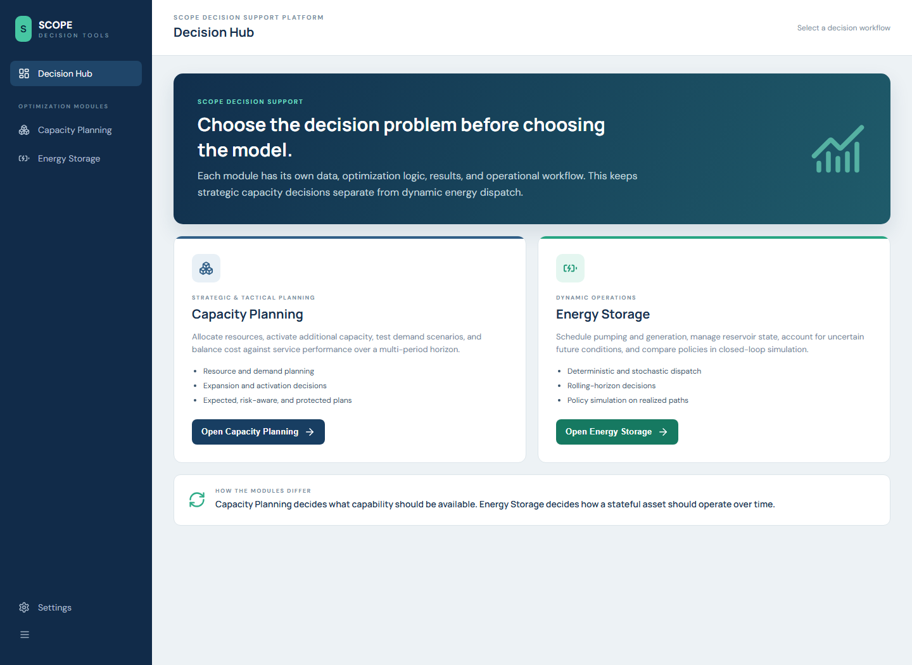
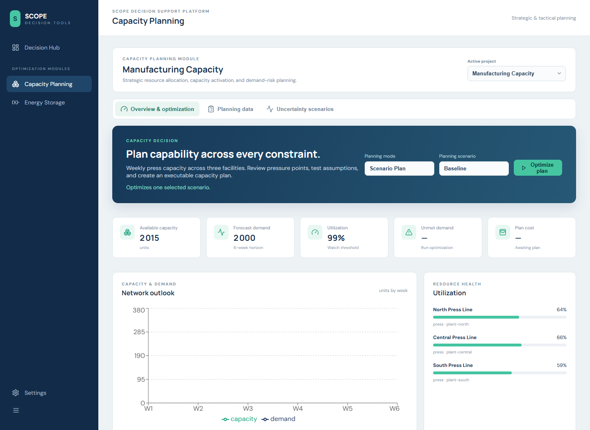
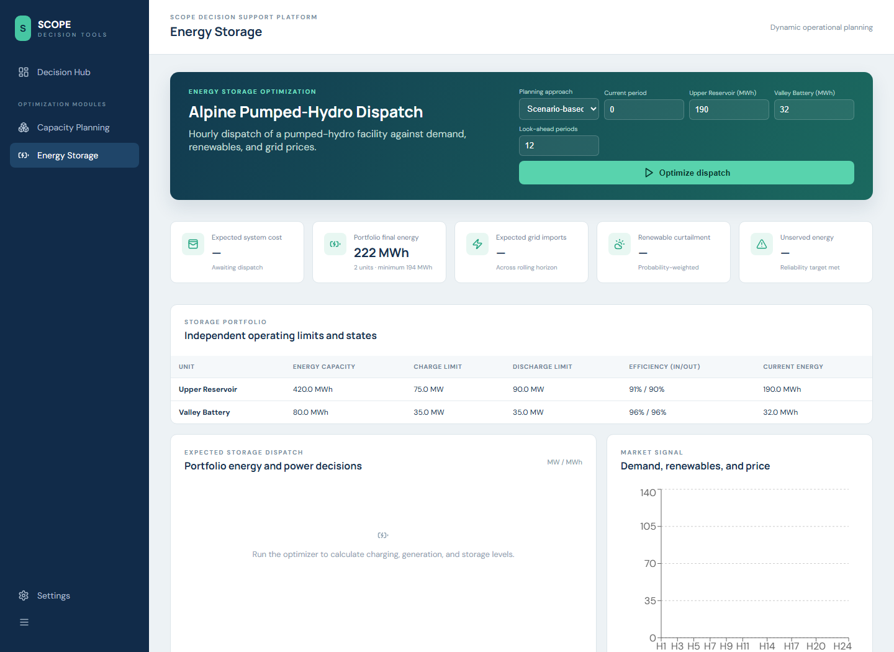

# SCOPE — Decision Support Platform

SCOPE is an open-source portfolio of optimization-based decision-aiding tools. It turns operational and strategic planning questions into explicit mathematical models, solves them with Pyomo and HiGHS, and presents the trade-offs in an interactive web application.

[](https://github.com/messabishabib/SCOPE/actions/workflows/ci.yml)
[](https://scope-decision-tools.lavishmoat129.chatgpt.site)

## Explore online

[Open the SCOPE portfolio showcase](https://scope-decision-tools.lavishmoat129.chatgpt.site) to explore the two decision workspaces, model pipeline, scientific documentation, and current research roadmap.

[](https://scope-decision-tools.lavishmoat129.chatgpt.site)

The online showcase is a static, presentation-focused demonstration. Run the repository locally to execute the real Pyomo/HiGHS optimization models and persist results.

### Application views

| Capacity planning | Multi-asset energy storage |
| --- | --- |
|  |  |

The current release contains two independent decision workspaces:

| Workspace | Decision | Methods |
| --- | --- | --- |
| Capacity planning | Which resources should be activated or expanded, and when? | Deterministic MILP, two-stage stochastic optimization, risk-aware and worst-case modes |
| Energy storage | How should a portfolio of storage assets charge, discharge, and interact with the grid? | Deterministic dispatch, scenario-based stochastic dispatch, rolling-horizon control, closed-loop simulation |

## Why this project

SCOPE is designed as both a working application and a transparent research artifact. Model assumptions, constraints, solver diagnostics, scenario performance, and known limitations are documented so decisions can be reviewed rather than treated as black-box recommendations.

## Highlights

- Multi-asset energy-storage portfolios with asset-specific power, energy, efficiency, cost, and inflow parameters
- Explicit nonanticipativity for scenario-based decisions before uncertainty is revealed
- Rolling-horizon reoptimization from the observed physical state
- Closed-loop comparison of deterministic and stochastic policies on the same realized path
- Strategic capacity planning with expansion, activation, lead-time, compatibility, budget, and shortage constraints
- Reproducible run snapshots, persisted results, CSV export, and solver diagnostics
- React decision dashboard, FastAPI service, SQLite persistence, and Docker-based startup
- Scientific model documentation with equations, limitations, validation guidance, and an upgrade roadmap

## Model documentation

- [Scientific article and roadmap](docs/energy-storage-model-and-roadmap.md)
- [Publication-ready PDF](docs/energy-storage-model-and-roadmap.pdf)
- [Energy-storage mathematical formulation](backend/app/modules/energy_storage/MODEL.md)
- [Software architecture](docs/architecture.md)

## Project layout

The backend and frontend use the same module boundaries:

```text
backend/app/
|-- core/                         shared identifiers and infrastructure
|-- database/                     shared SQLAlchemy session and metadata
|-- modules/
|   |-- capacity_planning/        API, schemas, optimization, services, persistence
|   `-- energy_storage/           API, schemas, optimization, simulation, persistence
`-- main.py                       application composition only

frontend/src/
|-- app/                          platform shell and Decision Hub
|-- modules/
|   |-- capacity_planning/        capacity workspace and components
|   `-- energy_storage/           energy workspace and simulation
|-- shared/                       API client, contracts, and reusable UI
`-- main.tsx                      frontend composition root
```

Module code may depend on shared infrastructure, but one decision module should not import implementation details from another module. Existing API paths and database table names are preserved across this refactor.

## Run with Docker

```bash
docker compose up --build
```

Open http://localhost:5173. The API is at http://localhost:8000/docs.

Individual workspaces can also be opened directly:

- Capacity planning: http://localhost:5173/?module=capacity
- Energy storage: http://localhost:5173/?module=energy

## Run for development

Backend (Python 3.11+):

```bash
cd backend
python -m venv .venv
.venv/Scripts/activate
pip install -r requirements.txt
uvicorn app.main:app --reload
```

Frontend (Node 24+), in another terminal:

```bash
cd frontend
npm install
npm run dev
```

## Test

```bash
cd backend
python -m pytest

cd ../frontend
npm run build
```

The same checks run automatically on every push and pull request through GitHub Actions.

## Build the scientific energy-model PDF

Quarto and Google Chrome or Microsoft Edge are required. On Windows, build the publication-ready PDF with:

```powershell
.\scripts\build-energy-model-pdf.cmd
```

The maintained source is `docs/energy-storage-model-and-roadmap.md`; the command creates `docs/energy-storage-model-and-roadmap.pdf`. Quarto also creates an intermediate self-contained HTML preview under `docs/_build/`, which is excluded from version control.

## API workflow

1. `GET /api/projects`
2. `POST /api/projects/{id}/runs` with `{"mode":"deterministic","scenario_id":"baseline"}`
3. Poll `GET /api/runs/{run_id}` until it reaches a terminal state
4. Download `/api/runs/{run_id}/export.csv`

## Current boundaries

The current release supports deterministic what-if runs, expected-cost two-stage planning, a blended risk-aware objective, finite-scenario worst-case protection, deterministic and stochastic multi-storage dispatch, asset-specific natural inflows by scenario, rolling-horizon execution, and closed-loop policy simulation. ADP/SDDP, grid outage/capacity limits, Excel import/export, authentication, and production-grade distributed jobs are not implemented. Unsupported minimum activation duration is rejected clearly during validation.

## Roadmap

The next energy-model milestone adds explicit spill decisions and grid import/export capacity limits. Later milestones cover asset-specific terminal values, degradation, risk measures such as CVaR, multistage scenario trees, and hybrid SDDP/MILP approaches. The maintained [scientific roadmap](docs/energy-storage-model-and-roadmap.md#9-development-roadmap) records the rationale and validation criteria for each upgrade.

## License

Released under the [MIT License](LICENSE).

